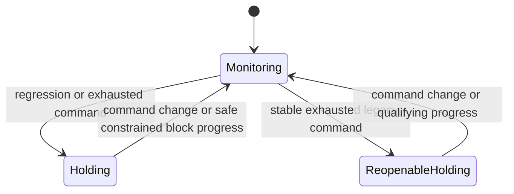

# Solver robustness and recovery

## Behavioral quality goals

A person commanding Cartesian motion should experience prompt, continuous,
predictable motion and automatic recovery when a reachable target returns.
Numerical feasibility and a `SUCCESS` status alone do not establish that quality.
These goals describe what a non-expert should experience when dragging a hand
target or sending Cartesian commands, without tuning solver internals or
manually resetting joint configurations. Evaluate the entire interaction:
starting, streaming, reversing, stopping, reaching a limit, and returning
from an unreachable target.
These are acceptance goals; individual solver paths must be validated against
their supported constraints and application control profile.

| Quality | Expected behavior | Evidence to measure |
|---|---|---|
| Responsive | New commands promptly produce useful motion or an explained limitation. | Command-to-motion latency, control deadlines, recovery search time and full loop time. |
| Fluid | Commands, reversals and recovery handoffs remain continuous; stopping is stable. | Configuration continuity, realized velocity, acceleration and jerk where the controller supports them, oscillation and mode-switch counts. |
| Natural | Arms and torso cooperate with task and posture preferences; feasible short motions avoid needless excursions. | Cartesian and joint path length, posture excursion, protected-hand drift, and visual review. |
| Recoverable | Returning from an unreachable target resumes useful motion without a joint reset. | Repeated exact target returns, time to resume and settle, and longest unexplained hold. |
| Predictable | Directional tracking is preserved when feasible; configured relaxation is explicit. | Realized task direction/scale, effective mode, terminal tolerance and rejection reason. |
| Safe | Recovery retains declared hard constraints and protected tasks. | Joint/velocity bounds, collision/support margins, contact invariants and applicable dynamics constraints. |

Set timing and comfort thresholds for the robot, task and control rate before
testing. Keep simulated motion duration separate from search computation and
wall-clock playback. A faster hypothetical search does not demonstrate faster
executed motion. A settled endpoint does not establish a smooth trajectory;
an acceleration or contact path needs its own qualification.

When motion is genuinely blocked, a stable hold with a useful reason is the
expected result. A stopped local solver or exhausted search budget does not
prove the target is impossible. Preserve the original Cartesian command and
reject stale recovery plans after target, state or policy changes.

### User-observable acceptance

Evaluate motion from the commander's perspective: does the robot respond to
their intent promptly, move coherently, and recover without intervention?
Ordinary Cartesian control should not require knowledge of task ranks, solver
modes or recovery internals. Automatic recovery remains subject to the declared
hard constraints; a failed local search is not proof of global infeasibility.

Pair recorded traces with visual review of starting, streaming, reversing,
stopping and far-and-back commands. Reviewers should check for noticeable
hesitation, unexplained pauses, chatter, abrupt handoffs, unnecessary folding
and excessive detours. Necessary torso support or a safe hold should be judged
against the task and constraints, rather than penalized automatically.

Record responsiveness, fluidity and naturalness separately as pass, fail or
unqualified, with the observed event and its timestamp. Numerical endpoint
success, a fast solve or a faster background search cannot compensate for a
failure in these dimensions. Missing motion or timing evidence remains
unqualified. Use the same commands, initial states, tolerances and supported
constraints when comparing solver paths.

### Ordinary-use quality gate

The behavioral goal is that an ordinary user can ask for a reachable motion
and see the robot find it fluidly, naturally and responsively. Include solution
finding itself in the review: hesitation during planning, repeated failed
attempts and a sudden transition into a valid trajectory are observable
quality defects even if the final pose is accurate.

Run these interactions through the documented application controls and defaults.
A recovery that requires an expert to select a seed, change solver modes or
reset joints does not pass the automatic-recovery goal. Record an opt-in
configuration separately until it is part of the supported control path.

Judge useful motion against the current command and any necessary recovery
route, rather than counting arbitrary joint movement. Test small corrections
as well as large reaches: moving a nearby target should not routinely trigger
a large posture excursion. Replace a command while recovery is running and
verify that the new intent takes effect without executing an obsolete route.

Report endpoint accuracy and each behavioral quality independently. A complete
usability pass requires the applicable quality gates to pass; missing evidence
or an unsupported constraint remains unqualified. This makes ordinary-use
quality a development and release criterion, with no claim that every current
solver path already meets it.

Retain per-interaction results and the worst observed hesitation or handoff;
averages can hide an occasional persistent stall. For a failed interaction,
record the user's command, expected response, observed motion and recovery
needed. Keep a reproducible regression for each repaired failure. A safe hold
can pass safety while still failing responsiveness or automatic recovery.

### GPU tracking precision and numerical quiet zones

The fixed and floating `GpuWbcMultiFrameSolver` constructors accept
`position_tolerance_m` and `orientation_tolerance_rad` for convergence checks.
Defaults are 0.008 m and 0.03 rad. Set these explicitly for matched CPU/GPU
tracking evaluations. Contact and hard-constraint checks have separate bounds.

Microscopic primary corrections are suppressed below 1 micrometre and
1e-5 rad, capped by the configured tracking and contact tolerances. This avoids
amplifying floating-point pose noise into unnecessary joint motion near a
singularity. The physical Jacobian, secondary tasks and safety rows remain
active; the suppression does not freeze an entire world. Larger streaming
commands keep their normal correction law. This numerical quiet zone is not
a substitute for acceleration/jerk control or smooth handoff validation.

Inactive and invalid GPU worlds have their primary correction requests masked
before bounded completion. With only primary pose tasks, finite Jacobians and
a joint velocity box containing zero, an exactly zero request also avoids
computing an unused primary inverse. This shortcut retains the physical
Jacobian and pose-error diagnostics. Secondary tasks, contact, collision,
support, torso constraints and nonzero required velocities retain their
normal factorization paths. Tracking tolerances and numerical quiet zones
are unchanged.

## Native hard-bound recovery preserves primary motion

When a moving-state affine task needs a new feasible ray seed, the generalized
CPU recovery first keeps any seed that passes its existing ray check. If the
initial search is inconclusive or its witness fails that check, recovery retries
seed construction once at a tighter precision. Before repeating construction,
it can project the auxiliary scale into `[0, 1]` and recheck the original hard
rows and affine ray against the unchanged physical command. A failed check
still requires the tighter search; no acceptance tolerance is increased.
A hard-set witness accepted at the caller's tolerance can otherwise retain a
small equality residual or a scale just outside `[0, 1]`. Original hard bounds,
ray validation, protected task images and caller fallback permissions remain
in force. A failed seed search does not prove the task globally unreachable.

### Opt-in SCALE rate refinement

CPU velocity and position-step callers can enable partial-rate refinement
through the runtime configuration:

```python
config = solver.runtime_config()
config.refine_partial_scale = True
solver.configure_runtime(config)
```

The default is `False`. Refinement seeks a larger feasible SCALE rate under
the existing bounds and earlier task priorities. It can add computation and
change the resulting joint trajectory; validate both response and trajectory
quality for the intended control profile. MIN_ERROR objectives retain their
existing behavior.

The native bound-release primitive supports `refine_partial_scale=True`.
Developers can additionally select `refine_from_origin=True` to initialize
the search with zero velocity and zero task scale when the velocity box
contains zero. This initializes the numerical search; it does not reset the
robot's configuration or publish an intermediate zero command.

`refinement_ray_tolerance` classifies rounded moving seeds. In origin mode it
also skips negligible scale changes and requests already at full scale within
that tolerance. Final candidate equality and box checks retain their separate
1e-8 thresholds. Boxes requiring inward motion retain a feasible moving seed.
Fixed-base GPU callers can select these options through
`GpuWbcMultiFrameSolver.from_robot()` with a native spectral backend; see
[GPU solver options](gpu_solvers.md#model-derived-api). Default solver behavior
is unchanged. With the default seed tolerance, GPU refinement can conditionally
restart a rounded float32 seed from a feasible zero origin. Near-full requests
retain their seed, and a restarted result must improve the actual float32 task
scale by more than 1e-5 before publication. Final equality and box checks remain
unchanged.

### Explicit native free-space corridor

`CartesianCorridorRecovery` is an opt-in C++ module for a fixed-base scalar
robot with two explicitly free hands. It owns guide stepping, bounded velocity
integration, original Cartesian success gates, and endpoint checks. Python
bindings expose the same module; the GUI does not need to implement its
acceptance loop.

Supply a dedicated `KinematicsSolver` containing one posture task and its
configured physical constraints. `CartesianCorridorOptions` specifies:

- `dt`: fixed integration timestep.
- `guide_mode`: preferred joint-guide objective, `SCALE` (default) or
  `MIN_ERROR`. Best-effort posture is explicit and applies to the guide;
  original Cartesian targets and endpoint safety/tolerance gates remain
  authoritative. The alternate guide mode is tried if the preferred mode has
  no admissible step. This does not change normal Cartesian task semantics.
- `guide_gain`: proportional gain for hypothetical and executed joint-guide
  velocities (default `3.0`, finite and positive). Increasing it can shorten
  convergence, but physical velocity limits, safety constraints and nonlinear
  endpoint checks still apply. Compare simulated duration as well as step count;
  increasing the integration timestep is not evidence of faster physical motion.
- `pose_caps`: a `2 x 2` matrix of intermediate position (m) and orientation
  (rad) error caps, one row per tool frame.
- `terminal_tolerances`: the same shape, checked against the original targets.
- `budget_velocity_constraints`: optional linearized radial velocity bounds
  for the Cartesian zones (default `False`). Near a zone boundary these steer
  best-effort posture motion inward instead of only rejecting proposals after
  solving. A 0.1% inward buffer and 0.8 gain leave room for local curvature;
  exact nonlinear endpoint checks remain mandatory. This mode requires a
  dedicated solver without external user velocity rows; it rejects existing
  rows rather than replacing them. Temporary rows are cleared after each step.
- `support_halfplanes`, `support_upper`, and `support_frame`: an optional
  root-fixed CoM endpoint envelope.
- `collision_floor_pairs` and `collision_floors`: fixed clearances for every
  exact geometry pair selected by the dedicated solver. Pair-set mismatches
  reject the candidate.

Call `start(q, guide, targets, both_hands_free=True)`, then
`step(q, targets, both_hands_free=True)`. Each accepted result satisfies
`q_next = q + dt * velocity`. Integrate only results with `accepted=True`.
Unaccepted results have empty executable outputs. A changed target, unexpected
input configuration, protected hand or incompatible solver-policy change
interrupts the guide. Re-arm from the actual current state with a new guide;
never assign the guide directly to the robot configuration.

The native lifecycle is `IDLE → ACTIVE → SETTLED`, with explicit `INTERRUPTED`
and `BLOCKED` outcomes. Settling requires both original Cartesian targets to
meet the terminal tolerances, rather than merely reaching a joint guide.
`computation_time_ms` includes native attempts and endpoint acceptance checks;
`solver_result.computation_time_ms` describes the last accepted inner solve.
An exact match to the previously accepted configuration reuses its endpoint
safety certificate. Every new candidate is checked. Keep robot geometry fixed
throughout a session; geometry changes require interruption and reactivation.

`find_guide(seeds, targets, max_iterations=300)` performs a bounded native
endpoint search using physical frame Jacobians and rotation-log derivatives.
Residuals are normalized by the configured terminal tolerances. Hypothetical
joint steps use box projection and true-pose line search; they are never
executed commands. The first endpoint meeting the terminal tolerances and
physical endpoint envelope is returned as `q_guide`, with `found=True`.
Failure returns an empty guide. The robot model configuration is restored on
return, and an active recovery must be interrupted before searching again.

Set `CartesianCorridorOptions.endpoint_safety_steering=True` to project
hypothetical Newton steps against joint trust boxes, up to eight nearest
collision-floor linearizations, and the declared root-fixed support halfplanes.
This opt-in search uses a separate native `MIN_ERROR` projection solver and
owned geometry query buffers without rebuilding the robot geometry or changing
the supplied solver's tasks, timestep or constraints. Hardware velocity limits
remain part of executed corridor steps, rather than hypothetical search steps.

Collision derivatives use separated nearest points with tighter query precision.
Penetrating or invalid nearest-point queries reject that seed; another seed may
still succeed. Geometry feature changes can invalidate a local derivative, so
these rows are search guidance, not a nonlinear safety certificate. The original
exact endpoint checks and subsequent corridor validation remain mandatory.
This option does not add acceleration/contact recovery or guarantee a shorter
route, faster playback, or successful search from every seed.

`allow_measured_state_updates=True` permits changed measured configurations
during an active velocity recovery. Every changed input is checked against the
original pose, collision and support envelope before proposing a step. An
accepted proposal integrates from that measured input, rather than the preceding
commanded configuration. Unsafe inputs interrupt recovery; changed targets and
unsupported solver policies still invalidate it. The default remains strict
matching of the previously commanded state. This option does not add velocity
history, acceleration/contact control or sensor-filtering support.

`allow_pose_zone_reentry=True` admits an already-outside pose when both hands
are explicitly free and its physical state passes the original safety checks.
Each outside position/orientation error must not increase; once inside, the
original zone applies again. The original cap arrays and endpoint tolerances
remain unchanged. This is a recovery policy for an already violated free-hand
zone, rather than a certificate that every intermediate pose was inside it.
It does not relax collision, support or joint constraints, and is unsuitable
for protected/contact tasks. The public default is disabled.

Keep search separate from the executed state. A background search should own
an independent surrogate model and solver; do not concurrently share the
control model. Discard results for obsolete targets and activate a retained
guide only from the actual current state. Internal exploratory configurations
need not be executed or rendered. Execution still follows the corridor gates.

`find_corridor_guide(q, seeds, targets, max_iterations=300, max_steps=600)`
also runs hypothetical native recovery steps from `q`. It tries another seed
when an endpoint's route stalls or exceeds the declared envelope, and returns
only a route reaching the original terminal tolerances. `corridor_verified`
and `rollout_steps` describe that sampled rollout. This does not certify swept
collision or a route from a different measured state; validate each executed
step again. Failed exploratory routes remain off the robot and display.

`warm_start_guide_backoff=True` optionally changes executed gain trial order.
After an accepted step it first tries one gain level above the last accepted
backoff, then visits the remaining original gain levels if necessary. Both
solve modes, all eight gains per mode, and every exact acceptance gate remain
available. The default is disabled. `accepted_backoff` reports the accepted
power-of-two gain reduction, or -1 when no candidate is accepted; `attempts`
counts actual velocity solves. A new activation or interruption clears memory.
This can reduce repeated rejected solves but may select a smaller gain than
the original order and change the trajectory. Qualify latency and fluidity
for the application; it is not an acceleration or smoothness guarantee.

Both search methods release Python's GIL. Use a dedicated surrogate instance
for a background worker. `cancel_search()` cooperatively cancels an in-flight
search; `search_running` reports activity. These two operations can be used
concurrently with a search. Other operations and model mutation must remain
confined to the instance's owning worker. A cancelled result has no executable
guide. Application adapters should also reject obsolete target generations.

This experimental module does not certify that a guide has a continuous
admissible path. It does not provide swept-collision, contact,
acceleration-history or GPU recovery. Intermediate free-space caps must never
be reused for a held/contact hand. Acceleration-history control requires a
separate adapter with measured velocity and an explicit continuity policy.
The default position-step controller remains unchanged.

Position and orientation frame components retain their physical Jacobian near
joint limits. Direct velocity solves preserve it for full-pose tasks as well,
and for `PostureTask`, including grouped and separate objectives. This permits
inward joint-guide motion from an upper limit instead of filtering it away.
Position-derived velocity bounds
restrict motion toward the limit without removing feasible inward motion.
A Jacobian column can oppose the requested Cartesian velocity yet be necessary
for a feasible coupled motion, so its dot product with the goal is insufficient
for deciding whether to remove it. Position steps retain their existing
nonlinear recovery policy; this direct-velocity correction does not establish
general nonlinear recovery.

### Opt-in partial SCALE refinement

The standalone `computeMultiObjectiveVelocitySolutionEigen()` API accepts
`refine_partial_scale=True` (default `False`). After a feasible partial SCALE
solution, it can release bound faces to increase the scale while preserving
earlier task values, physical interval constraints, and the requested task ray.
It starts from the existing feasible realization and keeps it if refinement
does not produce a verified improvement. This option does not alter
`KinematicsSolver` defaults or select a nonlinear recovery trajectory.

For CPU legacy commands whose damped partial result is not on its reported
ray, explicit refinement may construct a new ray-consistent feasible seed from
the verified task-entry witness. Earlier achieved task images and original
hard rows remain fixed. Only a certified larger scale replaces the old result;
the ordinary default-off path is unchanged.

The internal GPU `WarpBoundRelease` adapter has the same constructor option.
Its refinement requires a feasible, ray-consistent moving seed; full-scale,
non-ray and invalid-input worlds retain their existing handling. A rounded
float32 seed may fail the strict ray check and therefore retain its original
scale; the option does not promise optimum scale for every input. This is an
experimental optimization option: active-set refinement can cost substantially
more than the ordinary moving-world exit. Measure it on the intended batch
before enabling it in a control loop. It is not an automatic free-space or
contact recovery policy.

Final native constraint validation applies even when task scales sum to zero
or include the `MIN_ERROR` sentinel of `-1`. These values do not certify hard
feasibility. Check the returned status before integrating a native result.

For ordinary hard intervals, an invalid finite legacy result is checked for
proven constraint infeasibility. Contradictory intervals report `INFEASIBLE`.
A stationary result can instead be repaired in the nullspace of every task,
retaining its achieved task values while satisfying the original intervals.
The robot adapter also protects its physical primary Jacobian before task
filtering, including when a joint-space metric changes the decision variable.
This feasibility search runs on invalid results, not on healthy commands.
An explicitly enabled `MIN_ERROR` fallback remains eligible after a finite
final-bound failure; safety recovery may require changing the requested task
motion. Nonfinite solver state does not trigger this retry.
During minimum-error numerical recovery, an ill-conditioned trial set of
active bounds can still release a bound with a negative multiplier and
continue the bounded search. Releasing a trial bound does not relax the
constraint: every iterate remains subject to its original interval, and
success still requires the existing stationarity check.
Already-failed MIN_ERROR numerical recovery can retain a
certified point when a weak task-null direction amplifies
roundoff into a nonzero trial step. The certificate requires negligible
predicted quadratic improvement, a feasible command, tight active bounds,
nonnegative inequality multipliers within tolerance, and the existing
stationarity check. Scaling an objective down does not by itself satisfy this
test. Only an already-failed recovery search may immediately accept
the certificate, after revalidating the original constraints. This avoids
spending the remaining iteration budget resolving task-null roundoff; lower
task-null choices may differ. Proactive direct MIN_ERROR and weighted advisory
searches retain their original stopping rules. Protected task images remain
hard equalities, and iteration counts report the attempted search.
In generalized execution, a completed prefix may mix SCALE and MIN_ERROR
tasks. A checkpoint must satisfy every original hard row and preserve each
SCALE affine ray and each earlier MIN_ERROR task's completed image before it
can seed recovery of a trailing MIN_ERROR suffix. Recovery retains those
images and scales rather than demoting the directional tasks. Nonfinite or
changed prefix images do not qualify; the legacy velocity path is unchanged.
In the generalized solver, explicit fallback also covers an unsatisfied SCALE
equality whose trial scale remains positive, for example when part of the
requested task lies outside the Jacobian's range. Only the objective with the
failed equality is eligible; a valid higher objective retains its mode.
Direct legacy linear and velocity solves also reject a positive primary SCALE
success when the original target lies outside its task Jacobian's numerical
range beyond the configured equality tolerance. This includes inconsistent
targets on repeated or dependent rows. Explicitly authorized primary
`MIN_ERROR` fallback remains eligible. Consistent redundant tasks, supported
regularization and lower-priority projected preferences retain their behavior.
A failed result can retain a trial scale and a nonzero velocity that satisfies
hard intervals; neither makes it an accepted task solution. Check status before
using that velocity as a command.

Position stepping retains its established regularized pose-projection policy:
an overconstrained pose error can make useful projected progress even when its
complete instantaneous task ray is unrealizable. Its scale therefore does not
certify equality with the original unprojected pose request. The existing
numerically zero primary-row rejection and position acceptance/hold/safety
checks remain active. Direct velocity validation resumes after the position
call; position stepping does not change the solver's subsequent call policy.
For generalized affine tasks `J v + bias = scale * target`, active hard rows
can fix the task at an intermediate scale after its projected Jacobian loses
rank. Final validation recovers that scale only when the unchanged velocity
lies on the original affine ray and the scale is in `[0, 1]`. Original hard
bounds and every other SCALE task equality are still checked. This does not turn an
unsupported component into a feasible task or enable `MIN_ERROR` fallback.
If a finite legacy command with an explicitly requested all-`MIN_ERROR`
hierarchy violates its hard intervals, a nonzero primary command can be retried
with the constrained generalized hierarchy. Only a successful constrained
result replaces the invalid proposal. Healthy commands and SCALE policies
retain their existing path.

If that explicit all-`MIN_ERROR` hierarchy still produces an invalid command,
the CPU solver can recover with a feasible active-set search that releases
incompatible trial bounds. Each objective is optimized in priority order;
the achieved images of earlier objectives become equality constraints for
later ones. A feasible witness initializes the search and does not replace
task optimization. This recovery keeps the original hard intervals and does
not enable weighted fallback or soften constraints.

Acceleration-limited position stepping includes the original configuration's
CoM velocity rows in its outer command projection. With acceleration limits
enabled, both position-step APIs
check the final applied velocity against those rows using the outer control
interval, including after configuration clipping and continuity adjustments.
Endpoint support alone does not establish compliance with the velocity bounds.
The coupled outer projection uses stricter numerical accuracy than the task
solve. Projected joint velocities are snapped to their scalar bounds and the
full coupled rows are checked again before acceptance. Restoring a previously
computed command also requires that it lies inside the exact joint box;
task-solve tolerance is not extra acceleration headroom.
An infeasible result is a failed command; its hold output is not a certified
physical stop when the acceleration bounds exclude zero velocity. These checks
do not certify future contact dynamics or an entire braking trajectory.
Acceleration-off iterative position stepping retains its existing integration
semantics; this correction does not certify its total returned displacement
as one outer-interval CoM velocity command.

These position steps use `KinematicsSolver` velocity IK with joint
acceleration limits on command changes. They do not use the separate
`AccelerationSolver` acceleration-level dynamics backend.

With joint position and acceleration limits enabled, position steps also
constrain scalar joint motion to the true model limits over the actual
integration interval. Elastic position bands do not authorize an executed
step outside those limits. The solve also uses the existing outer joint
braking boundary, including its inset margin and configured acceleration,
so outer realization does not change the planned joint motion at that boundary.
If integration roundoff makes the acceleration interval miss an otherwise
valid scalar braking face, that face can be retained within the existing
machine-precision acceleration comparison allowance. This does not add task
solver tolerance as physical headroom or midpoint a contradictory interval;
larger conflicts still fail.
Contact paths apply these
position bounds to the projected velocity; this alone does not certify
contact dynamics or acceleration feasibility after projection.

If priority validation rejects every candidate and the resulting hold lies
outside the incoming acceleration interval, the result reports a numerical
failure, or retains an already established `INFEASIBLE` status, rather than
an executable `NO_PROGRESS` hold. Incoming velocity
history is retained. Failed position results do not advance velocity history.
The returned configuration is diagnostic; a failed
result must not be sent as a motion command. Exhausting the bounded search
does not prove that the constraints are infeasible.

If an invalid native velocity has a feasible alternative with the same achieved
primary motion, `KinematicsSolver` can repair its joint realization before
selecting weighted fallback. The correction preserves both the physical primary
Jacobian before limit/tangent filtering and the solver's filtered primary
Jacobian. It uses the existing constraint intervals and candidate safety checks;
lower-priority task errors can change. If recovery fails, the existing fallback
and rejection paths remain available. This does not establish nonlinear
convergence or GPU runtime equivalence.

## Zero minimum-error commands with mandatory motion

A zero `MIN_ERROR` target minimizes task velocity subject to the hard bounds.
If a bound excludes zero, the solver must still find a feasible nonzero command.
For example, a scalar task requesting zero with `0.85 <= velocity <= 1.0`
returns `0.85`, the closest feasible velocity. The native CPU path checks
hard-row feasibility before taking its zero-target shortcut; this also applies
to near-zero commands and rank-deficient frame objectives.

A satisfied zero task also retains its place in the hierarchy. Lower-priority
objectives can move only inside its remaining nullspace. For example, holding
the first joint at zero velocity while a lower task requests `[0.5, 0.5]`
produces `[0, 0.5]`: the second joint remains available. When an earlier task
creates a residual in a later zero-velocity objective, the solver processes
that objective rather than skipping it solely because its target is zero.

An unconfigured frame task has no commanded hold. In velocity assembly its
rows remain inactive until a pose or velocity reference is supplied; querying
its physical Jacobian still works. A stationary manipulability gradient also
leaves secondary posture motion available. This is distinct from explicitly
requesting zero velocity. In the legacy `solve_position` API, disabling all
pose feedback gains retains joint/nullspace-only optimization.

This does not change exact `SCALE` task-ray semantics or authorize relaxation
of higher-priority tasks. Acceleration-history recovery through
`CartesianCorridorRecovery` remains unsupported.

## Minimum-error convergence near task-null directions

The native CPU solver's numerical `MIN_ERROR` recovery can finish using a
roundoff-scale objective decrease and a KKT certificate. A tiny regularization
term can otherwise amplify roundoff into a nonzero joint-space step even after
the task has converged, exhausting the recovery iteration budget.

Certification requires the original hard rows, tight active inequalities,
nonnegative inequality multipliers within the existing numerical tolerance,
and a sufficiently small stationarity residual. Earlier achieved task images
remain protected. This applies to recovery after a failed prioritized solve;
the opt-in proactive direct-QP path retains its existing stopping behavior.
It does not enable `MIN_ERROR` fallback for a `SCALE` task unless that fallback
was already authorized, and it does not relax nonlinear validation.

### Acceleration-limited finite-pose projection

An acceleration-limited position step can refine a primary `MIN_ERROR` pose
objective against its actual finite-step endpoint. Preserving a Jacobian image
alone can leave pose error when a secondary task moves through the primary
task's nullspace. The bounded refinement compensates for that curvature while
keeping the original desired endpoint, lower-priority goals, and incoming
velocity history fixed. Internal trials do not advance physical time.

Only an improving candidate that passes the physical and pose checks is kept;
the existing outer nonlinear validation still applies. `SCALE` objectives are
unchanged. Uncommanded blocks retain their original velocity goals, and partial
orientation rows do not receive a full-orientation correction. Stored velocity
history reflects the command actually applied, rather than speculative trials.

### Unresolved hard-constraint feasibility

An unresolved Phase-I search can retry after releasing a negative-multiplier
active pin when its apparent motion lies in the feasibility objective's
numerical nullspace. This changes the search, not the acceptance conditions.
Only a finite witness satisfying every original hard row at the original
tolerance can replace `UNKNOWN`. Existing feasible witnesses and proven
infeasibility results retain their original path; the retry does not introduce
a new infeasibility certificate or relax a task priority.

## Feasible starting velocity for joints outside the primary task

The native hierarchical solver can start from a nonzero velocity when the
leading constraint rows form an identity joint box and zero lies outside that
box. It clamps zero to the box, then accepts that starting velocity only if it
leaves the primary objective unchanged and satisfies every hard constraint.
Later objectives account for this starting velocity through their normal
residual calculation. A lower-priority task involving these joints therefore
does not prevent required inward motion or collapse a feasible primary task
scale. Boxes containing zero retain the usual starting point.

This is a bounded initialization for task-null motion, not a general feasibility
search. Coupled constraints or a primary objective that rejects this velocity
retain the existing recovery path. It does not establish GPU equivalence or
resolve every position-step integration stall.

The GPU bound-release kernel accepts a clamped-zero starting velocity when
mandatory inward box motion leaves the homogeneous primary task unchanged.
If compensation is required, a bounded Phase I search maintains `Jv = α·target`
with `0 ≤ α ≤ 1` while reducing a separate common box slack. It can find a
positive task ray even when zero primary motion is incompatible with the box.
A checked feasible velocity and scale then enter task-scale maximization,
with slack fixed to zero, within the same kernel launch. Each phase
has a 256-iteration limit. Failed searches retain the original output.

When the task ray cannot achieve positive scale, mandatory inward motion can
still use a checked task-null velocity. The recovery flag records a repaired
velocity; it does not certify that the target was reached. Inputs already
achieving nonzero primary motion within the box retain their early exit. An
invalid moving realization can be repaired only if its achieved primary image
is retained, including its original task residual. This handles box
constraints and homogeneous task rays; it is not a general feasibility
search for arbitrary coupled constraint matrices. CPU execution
of the Warp kernel tests its mathematics; CUDA execution, graph replay and
performance require separate hardware checks.

This recovery kernel checks a strict homogeneous task ray. The legacy CPU
velocity path can have a nonzero least-squares task residual near rank deficiency
even when it reports scale one. Compare achieved task motion, residuals and
bounds when checking CPU/GPU parity; scale metadata alone is insufficient.

## Bounded recovery for stationary pose commands

A fixed-base `solve_position_step()` can retry a held `SCALE` pose command using
the original pose Jacobian and the existing analytic constraints. The retry
searches bounded joint-velocity regions and minimizes normalized joint motion
in the task nullspace. It tries up to twelve decreasing radii, then at most
three refinements between a rejected radius and an accepted radius. Every
accepted endpoint passes fresh pose and enabled collision, CoM, and relative
pose checks. A linear task scale alone is not an endpoint safety certificate.

During an accepted recovery, each active pose task's error norm must not
increase, and the combined errors must decrease. Position and orientation
errors stay within their values at the start of that recovery search. Individual components can vary between steps within those
bounds, which avoids imposing an unnecessarily strict requirement that every
component decrease on every step. Command changes reset the recovery state;
layout retries save and restore it with the other position-step state.

Cartesian position and orientation objectives retain their physical Jacobians
near joint limits. Joint velocity bounds enforce permitted directions without removing
inward motion or feasible task-nullspace combinations. This applies to velocity
and position-step solves, including groups of these component tasks. Removing
orientation entries near a joint limit can block legal inward rotations and
prevent a split pose task from recovering orientation at a reachable target.
Full-pose tasks and groups containing other task types retain their existing
Jacobian clamping behavior, except for the primary `MIN_ERROR` group in a position step.
For that group, the solver retains the physical Jacobian and intersects joint
velocity bounds with the actual integration timestep and position inset. This
prevents integration clipping from changing its predicted Cartesian motion at
valid scalar joint limits. Explicitly locked or globally excluded joints retain
their existing behavior, as do positions outside the true limits. This does not
guarantee convergence for an unreachable target or a locked configuration.
An eligible fixed-base position step containing a full-pose primary task can
evaluate one physical-model
alternative when the compiled primary Jacobian differs from its physical rows.
This alternative uses an exact inverse inside the actual integration box,
including explicit locks, and retains the registered secondary objectives.
It is accepted only if the existing pose and endpoint safety checks pass and
its endpoint improves the combined pose-block errors more than the current
result. The original velocity solve remains the default. This does not imply
convergence for every reachable pose or repeated boundary-return sequence.
If this alternative uses an explicitly authorized primary `MIN_ERROR` fallback,
its original physical linear residual must improve and all nonlinear checks
still apply. The result retains the `-1` scale sentinel and fallback metadata.
For an elastic position step at a valid scalar configuration, the solver can
first try an executable physical `SCALE` ray when projecting an expanded-band
realization to the true joint limits would change its Cartesian motion. This
additional solve retains the other task priorities and original hard rows,
disables primary `MIN_ERROR` fallback for this candidate, and applies the
existing nonlinear pose and endpoint safety checks. A positive checked ray is
preferred even when the expanded-band result reports a larger scale. If no
such candidate passes, the existing elastic alternatives remain available.
If the full bounded ray fails the nonlinear endpoint checks, the solver can
retry the hierarchy with primary requests capped at one half, one quarter and
one eighth of that scale. Each retry keeps the original hard rows and lower
task requests, solves their hierarchy again, and reports scales and errors
relative to the original primary goal. This also retains hard rows that require
nonzero motion; it does not scale an already solved velocity or its lower-task
diagnostics. The velocity wrapper uses zero affine objective biases.
The additional solve uses the existing recovery scope containing a full-pose
primary task and is only requested when execution changes the primary image.
Position-only, direct velocity, and acceleration-limited solves retain their
existing paths. The solver can also repair a moving realization whose primary
motion would change under integration
clipping. It retains the achieved physical and filtered primary images, all
existing hard rows, locks and endpoint safety checks, while finding a different
joint realization inside the true-limit integration inset. This repair does
not tighten the hierarchy's initial solve or inject movement into a stationary
primary command. It can change lower-priority task errors. If the checked repair
is unavailable, the existing integration and recovery paths remain; general
nonlinear convergence and every elastic-limit case are not guaranteed.

For a joint already inside its true limits, the integration inset caps motion
without forcing an inward restoration command. A stationary joint can remain at
a valid boundary, and a small inward command is not increased to reach the
inset. This preserves coordinated task motion while backtracking a candidate.
Outward motion near the inset is still restricted. Positions outside the true
limits retain the existing recovery clamp.

Direct collision stall escape is eligible only when an effective collision
floor is violated. A permitted negative per-pair clearance is not itself an
escape reason. Escape and joint-limit desaturation candidates preserve explicit
locks, exclusions and integration masks, true scalar joint limits, and the
physical hard rows from their matching velocity solve. Validation uses the
complete displacement over that solve's integration interval, including any
earlier accepted escape in the same step. Effective pair floors, support margins
and protected multi-target pose regions are checked at the candidate endpoint.

These direct heuristics conservatively hold when a complete matching constraint
snapshot is unavailable, including contact projection, softened rows, enabled
acceleration history, and active centroidal velocity constraints. Their endpoint
checks do not certify swept collision clearance or hardware dynamics.

The direct joint-limit desaturation heuristic also preserves coordinates in
`PositionStepOptions.locked_joint_indices` or `excluded_joint_indices`. A
zero-motion solve cannot unfreeze these coordinates to make recovery progress.
Its proposed endpoint also checks every active CoM half-plane. An edge that is
currently satisfied must remain satisfied; an already violated edge must not
worsen beyond the numerical tolerance.

This retry applies to fixed-base pose groups compiled to a `SCALE` objective,
without joint acceleration limits, contact projection, or velocity centroidal
hard constraints. Compatible grouped `SCALE_ELASTIC` tasks can also compile to
that objective; this does not establish recovery for every elastic-limit case.
Direct velocity solves keep their existing behavior. The regression suite
checks a saved feasible bimanual pose return at 20 ms and 25 ms control intervals,
with true joint limits, pair-specific collision floors, and CoM bounds checked
throughout. This coverage does not establish GPU or swept-path equivalence.

## Rectangular singular-inverse damping

The legacy inverse path retains full left singular vectors. For a tall matrix,
per-singular-value damping uses only the columns corresponding to the singular
values. Multiplying the full matrix by the shorter damping diagonal produces
incompatible dimensions and can generate non-finite state in release builds.
The correction preserves the other inverse branches and physical constraints.
Regression coverage compares tall, wide, square and singular problems with an
independent regularized-Gram result and repeats exact-limit fallback recovery.

EmbodiK keeps **recovery policy in the C++ solver**, not in example-side guard code. The same
`KinematicsSolver` that tracks your end-effector also decides how to unstick near joint limits,
collision margins, and singular layouts — while still respecting hard constraints.

!!! info "Related guides"
    **Collision tuning** (Speed / Balanced / Precise, bounds, post-step guards) →
    [Collision Constraints & Tuning](collision_constraints.md).
    **Guide map and reading order** → [Guides overview](guides/index.md).
    **Runnable teleop** → [Teleop IK](examples/teleop_ik.md), [Collision-Aware IK](examples/collision_aware_ik.md).

## Solver-owned vs app-owned

| Concern | Typical naive stack | EmbodiK |
|---------|---------------------|---------|
| Stuck at joint limit | App lowers gains or nudges joints manually | **Elastic band** expands limit margins temporarily; **SCALE_ELASTIC** task mode bundles this |
| Stuck at collision margin | App disables collision or shrinks targets | **Stall handler** relaxes margin only when collision rows bind; **non-worsening floors** for structural pairs |
| Pose task overconstrained | App splits position/orientation tasks by hand | **Auto task layout** switches merged ↔ split at solve boundaries |
| Priority stack infeasible | App drops tasks or switches to Jacobian transpose | **Weighted fallback** accepts a constrained weighted candidate under the same hard limits |
| Large marker jump | App retunes `dt` or gains per scene | **Adaptive dt** scales integration step with error (capped near collision) |
| Penetration creep | Hope QP constraints are enough | **Post-step acceptance** rejects deepening penetration (see collision guide) |

Hard constraints stay in C++ for all of the above: joint limits, collision, CoM polygon,
contact projection, and linear inequalities.

## Runtime policy (`SolverRuntimeConfig`)

### Experimental normalized pose recovery

`normalized_pose_recovery_enabled` is an opt-in development policy, disabled
by default. It currently applies to fixed-base scalar position steps with a
primary full-pose objective permitting minimum-error fallback and a secondary
posture objective, without acceleration limits, contact projection, or hard
velocity centroidal constraints. It is not GPU or acceleration-solver recovery.

Position and orientation errors are normalized by
`normalized_pose_position_tolerance` and
`normalized_pose_orientation_tolerance` (defaults: 5 mm and 10 mrad).
Candidate admission requires nonlinear progress for each hand, protection of
already satisfied pose blocks, executable joint bounds and the existing safety
checks. These parameters do not define a complete online contact policy.

A checked candidate that brings previously unsatisfied continuity tasks inside
their satisfaction region is allowed to complete that motion. Its zero
normalized merit does not cause the continuity guard to hold the unsatisfied
seed instead. Already-satisfied commands retain the stationary hold policy;
all other safety and priority checks still apply.

An optional finite `normalized_pose_recovery_reference` of size `nq` supplies
an alternative pose-solution guide. It does not replace the current robot
configuration. A reference outside physical joint limits or inconsistent with
current targets is ignored; a satisfied command does not follow the guide.
The guide also needs an admissible bounded step from the current state. If
none passes the nonlinear pose and safety checks, its joint-distance condition
does not veto the ordinary Cartesian recovery candidates.
During guided recovery, candidates must also reduce joint distance to the
reference. The solver first attempts an executable physical SCALE ray, then
bounded pose progress using the explicitly allowed minimum-error fallback.
Guide consistency can reject a locally improving SCALE realization that moves
away from that reference. Diagnostics report accepted fallback semantics.

The caller supplies the reference; automatic search, continuous collision
certification, and general convergence are not provided by this experimental
API. A valid endpoint alone does not prove a safe or executable route.

### Rank and target reachability

During hierarchical task scaling, the ESNS rank check still stops the active-set
loop when the projected Jacobian falls below the task's rank budget. That budget
is the row count. A consistent explicit zero row, repeated row, or linear
combination of earlier rows is the same task, so it is left out of the budget:
it does not end the loop, inflate damping, or report a rank failure. A
consistent full-rank row uses the same saturation when its uniform scale is
zero, including past the default iteration cap. Bounds violated by the
full-scale step are saturated together when that set still reaches the target.
If it does not, only the joints that force the scale to zero are saturated, and
joints that still allow a positive step stay free. If the resulting free-joint
solution still exceeds a bound and the pinned joints are at the origin, the
reported scale is the largest value that keeps the velocity inside the box. A
positive uniform scale is left as that scaled step. A structurally singular
Jacobian, or an inconsistent extra row, keeps the original row-count check. An
all-zero Jacobian reports scale 0 when its target is nonzero. Inconsistent
targets still require scaling or an explicitly enabled error-reduction
fallback; this check does not relax hard constraints. The GPU native velocity
solve, FI-PeSNS, and PPH-SNS apply the same completion: a zero-width bound stays
pinned, the free joints resolve that task without extra rank damping, and the
same homogeneous partial scale is reported when scale 1 does not fit. A step
that does not move a nonzero target reports scale 0. Other GPU tasks keep
uniform bound scaling.

Most interactive examples call `configure_solver_runtime_policy(solver)` to enable the default
robust teleop bundle:

```python
import embodik as eik

solver = eik.KinematicsSolver(robot)
cfg = solver.runtime_config()
cfg.enable_auto_task_layout = True
cfg.weighted_fallback_enabled = True
cfg.adaptive_dt = True  # optional; stamp into PositionStepOptions via make_position_step_options()
solver.configure_runtime(cfg)
```

| Flag | Default | What it does |
|------|---------|--------------|
| `weighted_fallback_enabled` | **on** | After a non-success prioritized solve, may accept a **constrained weighted** MIN_ERROR candidate that still satisfies collision, limits, CoM, etc. |
| `enable_auto_task_layout` | off in raw solver; **on in examples** | Toggles **merged 6D pose** vs **split position + orientation** tasks when binding score says one layout fits better |
| `adaptive_dt` | off | When stamped into `PositionStepOptions`, scales integration `dt` with position error |
| `joint_limit_non_worsening_enabled` | off | Inside `joint_limit_non_worsening_margin`, prevents finite scalar joint-limit slack from decreasing while retaining inward and tangent motion |
| `weighted_advisor_enabled` | off | Computes weighted candidate every step for diagnostics without changing authoritative output |

Prioritized SNS remains authoritative on **success**. Fallback and layout switches happen at
**solve boundaries** — the solver does not silently rewrite your registered task list mid-tick.

### Auto task layout

`PoseTaskGroup` adapters can register both a merged `FRAME_POSE` task and split
position/orientation tasks. With `enable_auto_task_layout`:

1. Start on **merged** layout (fewer rows, faster when it works).
2. Switch to **split** when the previous constrained solve’s **binding score** exceeds
   `auto_layout_binding_threshold_high` (default 0.30).
3. Switch back to merged after `auto_layout_cooldown_ticks` consecutive scores below
   `auto_layout_binding_threshold_low` (default 0.15).

Useful when orientation rows fight position rows near singular or boxy workspaces — the solver
picks the layout, not the teleop script.

Automatic switching requires a `PoseTaskGroup` registered with `auto_switch=True`.
Enabling the runtime policy alone does not split raw `FrameTask` objects or
fixed-layout groups, and those tasks do not trigger a split retry.
`active_task_layout` describes active frame task types, including tasks combined
at the same priority: pose-only tasks report `MERGED`; component tasks report
`SPLIT`. A mixture of pose and component tasks also reports `SPLIT`, so inspect
the task types when that distinction matters. Inactive tasks do not affect it.

### Weighted fallback

When the priority stack cannot make progress (`INFEASIBLE`, `NO_PROGRESS`, etc.), the solver
may evaluate a **weighted stacked** velocity solve under the **same hard constraints**. If that
candidate is feasible, it can replace the failed prioritized step (`recovery_stage` reports
`WEIGHTED_FALLBACK` in diagnostics).

If the weighted solve encounters a cycling or inconsistent active set, it retries
from a feasible point. The retry keeps fixed coordinates and hard bounds active,
including one-sided bounds, and checks feasibility before accepting a command.
Successful weighted solves retain their existing path. This improves recovery
of the constrained weighted problem; it does not guarantee that a nonlinear
pose trajectory will reach its target.

The low-level `computeConstrainedWeightedVelocitySolutionEigen()` function also
accepts `initial_solution=velocity`. Use this when a preceding solve has already
provided a feasible point, for example when fixing its achieved value before
optimizing a secondary objective. The point must have the current velocity
dimension, contain finite values, and satisfy the current hard rows within
`solver_tolerance`; invalid or stale points return `INVALID_INPUT`. The solver
optimizes from that point and still checks the final hard constraints. Passing
`None` keeps the existing initialization path. This option does not change the
high-level solver's fallback policy or preserve priorities on its own; encode
any required primary values in the secondary problem's hard constraints.

Disable only for strict-priority A/B benchmarks — not for production teleop.

### Active joint-limit non-worsening

Enable `joint_limit_non_worsening_enabled` when a limited-ROM robot must not
spend its remaining joint-limit margin to follow an infeasible Cartesian
direction:

```python
cfg = solver.runtime_config()
cfg.joint_limit_non_worsening_enabled = True
cfg.joint_limit_non_worsening_margin = 0.02  # joint coordinates; default 0.04
solver.configure_runtime(cfg)
```

The policy requires position limits to be enabled. For each finite scalar joint
inside the activation margin, the solver adds an inward/tangent velocity
half-space. When acceleration limits are enabled, a sampled-data stopping bound
starts limiting outward speed before the margin so the command reaches the
half-space continuously. An outward `SCALE` objective is first represented by
its closest achievable Cartesian tangent objective; exact task motion through
the task nullspace is retained when feasible. The same hard interval then
constrains `MIN_ERROR`, posture, manipulability, and other lower-priority
objectives, so a secondary task cannot reintroduce the removed outward motion.

The policy is default-off because the useful activation width depends on robot
range of motion and control rate. It does not replace hard position limits or
relax collision, CoM, contact, or velocity constraints. Normal integrated motion
remains inside the configured acceleration corridor through sampled braking. If
an external state synchronization makes remembered acceleration history
incompatible with the active limit interval, the limit interval takes
precedence for that solve. Non-finite or non-positive margins are rejected when
the policy is enabled.

## Task solve modes

### Inspect collision candidates

Set `PositionStepOptions.record_collision_candidates = True` to capture the
nominal post-integration collision check and its backoff candidates in
`PositionIKResult.collision_candidates`. Each record contains reference and
candidate configurations, effective per-pair recovery margins, the global
distance threshold and the floor acceptance decision. Margin vectors use the
robot collision-pair order; inactive entries can be non-finite.

Tracing is disabled by default. These records cover the position-step collision
check and backoffs, not every solver stage or continuous swept-volume safety.

Per-task `TaskSolveMode` controls how strictly a frame task must be met each velocity step:

| Mode | Behavior | Typical use |
|------|----------|-------------|
| `SCALE` | Task rows scale down under conflict (elastic priority) | Default teleop |
| `MIN_ERROR` | Minimum-error objective under hard constraints | Recovery near body; stall unfreeze |
| `SCALE_ELASTIC` | Like `SCALE` + automatic **elastic band** on joint limits | Whole-body teleop near limit saturation |

`PositionStepOptions.primary_allow_min_error_fallback = True` retries a stalled primary
`SCALE` / `SCALE_ELASTIC` step once with **MIN_ERROR** while keeping collision and CoM active —
see [Collision-Aware IK](examples/collision_aware_ik.md).

When collision recovery requires positive separating velocities and a task
needs tangent projection, the projection includes every active direction with
a positive recovery lower bound. The hard rows supply this mandatory motion;
the task scales within the remaining tangent space. This prevents coupled
recovery rows from imposing an infeasible task ray as its scale decreases.
If multiple independent positive recovery normals remove every task direction,
the zero tangent objective still permits mandatory hard-row recovery. A fully
collapsed projection for a single recovery normal or approach-permitting bounds
keeps the original task ray and fallback policy. Physical task Jacobian queries
remain unchanged.
A task that already satisfies every separating bound keeps its original
objective. Hard bounds and task priorities continue to apply, and this
projection does not enable minimum-error fallback.

At an exact joint position limit, the permitted outward velocity is zero.
When saturation selects an unnecessary bound, a feasible task can appear
blocked. The CPU velocity solver now attempts bounded active-set recovery
before accepting zero progress or an enabled minimum-error fallback. It can
release a bound while retaining the task ray, prior task values and original
hard intervals. The search requires a feasible zero-scale witness at objective
entry; it leaves the existing solution unchanged when that certificate is
unavailable. Existing positive-scale solutions keep their behavior.

`SCALE` retains its direction-preserving behavior: a blocked component can
reduce the entire task scale to zero. Set the task's
`allow_min_error_fallback = True` to allow constrained partial error reduction
when scaling collapses, including at an exact upper or lower limit. This keeps
the position bounds unchanged; it does not enable elastic margins. Task-level
fallback and the runtime weighted fallback are separate recovery mechanisms.

For a CPU-only reproduction with a generated two-slider robot, run:

```bash
pixi run python examples/harnesses/joint_limit_recovery_harness.py
```

The harness compares strict scaling, task fallback, explicit minimum error and
weighted fallback. It also demonstrates redundant-joint redistribution and an
active-constraint release case. Its algebraic global-scaling comparator is not
a GPU execution or a performance benchmark.

## Stationary-target continuity

`solve_position_step()` evaluates nonlinear Cartesian merit over a 20-call window after the same
pose target and solve policy remain unchanged. Productive windows continue even when individual
joint steps reverse direction, as can happen while an automatic layout or redundant whole-body
solve makes useful net progress. A window that moves without enough merit reduction, or repeatedly
reverses without strong net progress, activates a hold at the last accepted configuration. The
minimum absolute benefit scales with the number of calls in the window, so a longer policy dwell
cannot hide the same low-rate drift. Aggregate progress also cannot excuse repeatedly worsening
the currently worst commanded target. This prevents persistent null-space motion, target trading,
and limit cycles after a far or constrained target has exhausted useful progress.

For a pure velocity-level position step, the solver also remembers whether the target has actually
moved since continuity state was initialized. Once that moving target becomes stationary, the
solver anchors each commanded target's position and orientation error at that stop boundary. A
candidate that worsens the anchor's dominant error block beyond the numerical tolerance is held
immediately instead of being integrated for the rest of the 20-call dwell. The anchor remains fixed
while the command is stationary. Candidates may still trade smaller error blocks while preserving
the dominant block and making sufficient net progress over the continuity window, so workspace-edge
convergence and singularity recovery do not require an acceleration bound or joint-space reset.

This immediate non-regression check is deliberately disabled when acceleration limits are active,
where sampled braking governs continuity, and when constraint paths that can require target-error
tradeoffs are active. Those paths include collision, CoM, relative-pose, torso-pose, user linear,
tight frame/point, contact projection, and protected-task viability constraints. They continue
through the windowed continuity and constraint-specific acceptance logic so tangential or coupled
recovery is not converted into a hard hold.

The hold is mode-agnostic: it applies to `SCALE`, `SCALE_ELASTIC`, and `MIN_ERROR`, including the
single-target and multi-target APIs. A held target that is already satisfied remains `SUCCESS`;
an unsatisfied target with no useful nonlinear progress reports `NO_PROGRESS`. In both cases,
`q_solution` and the reported applied velocity describe the unchanged configuration.

The window restarts when an explicit step target, registered task target or control state, task
policy, step option, runtime configuration, or task graph changes. This includes lower-priority
posture and torso objectives, so a new command can make progress immediately even when a
higher-priority target is already held. A hold caused by low progress can reopen when a later
candidate becomes efficient. Explicit collision rejection and stall-escape candidates bypass the
merit hold. Samples produced inside a collision margin remain part of the continuity window,
preserving productive tangential sliding without allowing repeated contact-bound cycling to
masquerade as recovery.

For constrained solves, a latched hold also reopens when a freshly validated candidate
makes sufficient aggregate progress, reduces every unsatisfied pose-error block, and
keeps already satisfied blocks within the existing commanded-error satisfaction tolerance.
Requiring machine-precision improvement of an already satisfied block would reject useful
coupled motion with small nonlinear residuals. This permits recovery
after active constraint rows change or measured state moves away from a limit. Historical
oscillation alone does not veto this fresh progress; collision and priority checks still apply.

When an adapter re-expresses one source command into changing world-frame poses, set
`PositionStepOptions.continuity_command_revision` to a non-negative caller-owned revision. Keep
the value unchanged while the source command is unchanged, and increment it when target geometry
or ownership changes. With this explicit identity, derived pose changes do not restart the
continuity window. Once strong nonlinear progress is exhausted, the hold remains latched until the
revision, task policy, or task graph changes, subject to the constrained blockwise-progress
exception above. This avoids low-rate self-motion from repeatedly
re-derived targets while preserving one-tick command recovery. The default value `-1` retains
automatic pose-based identity and its reversible low-progress hold.

Adapters that add their own outer-loop velocity or acceleration continuity must preserve this
hold contract after the native solve. If the source command is unchanged and the accepted
position-step output is a hold, publish the unchanged configuration and zero applied velocity.
Resume when the command identity changes or the solver accepts fresh recovery progress.
If an adapter synthesizes an equivalent app-owned hold from repeated
stationary residual or reversal motion, latch that app-owned hold on the same command identity too.
Otherwise an outer-loop filter can reintroduce low-rate self-motion even though the IK target is
stationary.

Adapters that recenter a nullspace posture anchor after each accepted step should use
`PostureTask.set_reference_configuration()`. It updates the regularization reference without
declaring a new command on every tick. Use `set_target_configuration()` or
`set_controlled_joint_targets()` for commanded posture changes; those setters restart the
continuity window so useful motion resumes immediately.

## Adaptive integration timestep

Large marker jumps need larger effective steps; near the target, small steps prevent overshoot.
With `adaptive_dt=True`:

```text
effective_dt = dt × clamp(pos_error / reference_distance, 1.0, max_scale)
```

Defaults: `reference_distance=0.05` m, `max_scale=5.0` (override via `SolverRuntimeConfig` or
per-call `PositionStepOptions`).

**Near collision:** if clearance to the active constraint margin is tight, adaptive scaling is
**capped** so a larger `dt` cannot outrun what the margin allows — avoiding “teleport through”
the safety shell.

Enable for iterative position solving:

```python
opts = solver.make_position_step_options()
opts.adaptive_dt = True
result = solver.solve_position_step(q, target, "ee_task", opts)
```

### Commands at a fixed control interval

Velocity limits apply to each internal integration step. Multiple steps or an
adaptive timestep can produce a total configuration change larger than one
control interval permits. Publishing that result at the base `dt` does not
preserve the internal steps' velocity bounds.

For a controller publishing one command every 10 ms, use one fixed step and
enable the bound relative to the input configuration:

```python
opts = solver.make_position_step_options()
opts.dt = 0.01
opts.max_steps = 1
opts.adaptive_dt = False
opts.limit_change_from_seed = True
result = solver.solve_position_step(q, target, "ee_task", opts)
```

This example assumes scalar joint coordinates and configured model velocity
limits. Keep hypothetical search iterations in a separate state, and validate
the accepted command against the interval used by the controller.

## Elastic band joint limits

When several joints sit on their limits, the QP can lose degrees of freedom and **collapse task
scale**. Elastic band **temporarily widens position limit margins** on saturated joints:

- Expands after repeated limit-dominated stalls (`expand_rate`, `stall_threshold`).
- **Decays** when solves are healthy again (`decay_rate`).
- Capped per joint (`delta_max`, default 0.05 rad).

Enable explicitly:

```python
solver.enable_elastic_band(0.05)
# or per step:
opts.elastic_band = True
```

Or use `TaskSolveMode.SCALE_ELASTIC` on frame tasks for the same mechanism with tuned defaults.

## Stall handler (collision margin recovery)

Distinct from **solver stall** status and from **eval harness Hold%**:

```python
solver.enable_stall_handler(nominal_min_distance=0.04)
opts.stall_recovery = True  # persists across solve_position_step calls
```

After consecutive near-zero-velocity failed solves, the handler may **ratchet down** effective
`min_distance` — but **only when a collision constraint row is actually binding**. Joint-limit
stalls do **not** open collision margin (prevents driving the arm into the body).

Margin **restores** gradually toward nominal when solves succeed again.

Pair with non-worsening floors for structurally close pairs ([Collision Constraints](collision_constraints.md#non-worsening-recovery-floor)).

## CoM support polygon

`configure_com_constraint()` adds half-plane velocity inequalities so the projected CoM stays
inside a support polygon, with:

- **Margin shrink** via `char_size` (mean centroid-to-vertex distance).
- **Velocity and acceleration caps** near the boundary (smooth approach, reduced overshoot).
- Optional **proximity activation** — rows enter the QP only when CoM slack is within a fraction
  of polygon inradius (cheaper when the CoM is comfortably inside).

See [CoM Constraint Example](examples/com_constraint_ik.md).

## Stationary minimum-error compromises

For an unchanged position-step command, a minimum-error candidate may reduce
the aggregate residual while worsening the already worst target. Without
acceleration, collision, CoM, contact, or other hard-constraint tradeoffs, the
continuity guard rejects that regression as soon as its existing tolerance is
exceeded instead of waiting for the full dwell window. This also covers modes
selected directly as `MIN_ERROR`, as well as scaling fallbacks. Changed targets
reset the stationary hold, allowing the solver to resume on the next call.
Scaled candidates retain the windowed policy so nonlinear corrections can keep
making useful progress. This policy does not guarantee that infeasible targets
can be reached or that every target decreases on every iteration.

The stationary controller keeps one of three internal states:

| State | Reopening condition |
| --- | --- |
| Monitoring | Evaluate candidates and accumulate progress evidence. |
| Holding | A changed command, reset, or safe constrained improvement of every commanded block. |
| Reopenable holding | The same conditions, plus sufficient aggregate progress for legacy commands without an explicit revision. |



Speculative retries snapshot and restore this state together with the merit
window. Numerical fallback modes, constraint feasibility, and collision safety
remain separate decisions: a continuity state alone is not a safety certificate
or proof that an unreachable command can be tracked.

## Diagnostics worth logging

`VelocitySolverResult` / `PositionIKResult` expose solver state for UI and tests:

| Field | Meaning |
|-------|---------|
| `condition_number` | Worst task Jacobian condition number this step — high ⇒ sensitive posture |
| `binding_score` | How hard inequality rows (limits, collision, CoM) constrained the step |
| `recovery_stage` | `PRIORITIZED` vs `WEIGHTED_FALLBACK` |
| `task_scales` | Per-task scale under SCALE modes |
| `collision_rejection_count` | Post-step guards rejected integration |
| `stall_escape_count` | Jacobian escape nudges out of penetration |

Use these in Viser panels and regression tests instead of guessing from motion alone.

### Opt-in hierarchical problem snapshots

For CPU velocity and position-step diagnosis, enable recording explicitly:

```python
solver.enable_problem_tracing(True)
result = solver.solve_position_step(q, targets, options)
trace = solver.get_last_problem_trace()
for problem in trace.velocity_problems:
    replay = embodik.replay_velocity_problem(problem)
    # replay.solution is in backend coordinates. Convert to physical velocity:
    dq = problem.backend_column_scale * replay.solution
solver.enable_problem_tracing(False)
```

Recording is off by default. Each public request replaces the previous trace;
position-step requests retain their nominal backend calls, including retries.
The getter returns an owned snapshot. Disabling recording releases the retained
trace. Recording copies matrices and configurations and is intended for
diagnosis, not latency measurements with recording disabled.

Each velocity problem contains the actual hierarchical goals, Jacobians,
bounds, softening factors, objective policies, numerical configuration and
backend variable mapping. `replay_velocity_problem()` runs that nominal
hierarchical backend, preserving its policy and ordering. It does not replay
later adapter recovery, contact projection, integration or collision acceptance.
`backend_solution`/`backend_status` and `returned_velocity`/`returned_status`
describe these different stages; a backend success is not a physical acceptance
certificate. Constraint residuals must be interpreted in the recorded backend
coordinates.

For multi-target position stepping, `priority_candidates` records proposed
configurations, per-task position/orientation merits, task names/priorities and
the accepted backtracking fraction. The trace also records the final returned
configuration, status and hold flag. Geometry snapshots and continuous swept
collision validation remain separate from linear backend replay.

`continuity_decisions` records each continuity guard's actual seed/candidate,
merits, commanded blocks, prior window sample/reversal counts and whether it
was already holding. Its `held` flag and `reason` identify the guard decision;
later safety checks can still reject a candidate. These records diagnose
stateful decisions and do not constitute a complete solver-state replay.

### Individual target merit budgets

Same-priority targets retain aggregate position/orientation merit protection by
default. For independent hand budgets in a multi-target CPU position step:

```python
options.per_target_priority_budgets = True
right_target.priority_orientation_tolerance = 0.002  # radians
left_target.priority_orientation_tolerance = 0.01
result = solver.solve_position_step(q, [right_target, left_target], options)
```

Each explicitly configured positive position/orientation tolerance is protected
independently, including targets without a lower-priority task. The solver adds
local physical velocity rows and checks finite integrated candidates against
each original target. An initially exceeded budget permits recovery without
further worsening; it does not demand an instantaneous error correction.
Numerical slack is attached to the configured budget rather than accumulated
on successive calls. Masks and zero gains retain their commanded-block meaning.

Budgets and the policy flag may change between calls without resetting targets.
A smaller budget cannot make an infeasible direction achievable; a hold remains
possible. These are local position-step protections, not global path planning,
contact guarantees or an API for the separate `AccelerationSolver`.

For fixed-base additive scalar joints without acceleration, contact or active
velocity centroidal constraints, explicit budgets also enable bounded
partial-SCALE refinement during the position step. This lets redundant joints
support motion instead of accepting an unnecessarily small tangent-row scale.
The caller's runtime refinement setting is restored afterward.

When finite kinematic curvature exceeds an explicit budget, disposable FK
probes form local corrective inequality rows. Up to four correction attempts
share the existing eight-retry budget. These rows do not relax the original
budget or other constraints; every proposal still passes the original nonlinear
endpoint guard. Temporary rows are restored before returning. Unsupported
configurations retain the existing interval-backoff behavior.

If a rejected retry does not add a correction, its interval or terminal fraction
contracts by at least half. Repeating a near-one backtracking fraction cannot
consume the budget on essentially unchanged proposals. A hold remains possible
when no candidate passes the unchanged final acceptance checks. These local
corrections do not certify a continuous swept path.

### Explicit original collision-floor anchors

For velocity-only position stepping, callers may retain the original clearance
of every configured geometry pair:

```python
solver.set_collision_trajectory_floor_anchor(q_initial, tolerance=1e-9)
# Change targets and call solve_position_step() normally.
# Explicitly end or replace the original-floor contract when appropriate:
solver.clear_collision_trajectory_floor_anchor()
```

For each named pair the fixed floor is `min(distance(q_initial), minimum_distance)`.
It persists across calls and target changes. The configured tolerance is applied
once to this fixed floor; it is not accumulated per command. The anchor overrides
ordinary nominal/structural recovery targets, disables implicit stall-handler
margin relaxation, and remains fixed if nominal margins change. Clear or replace
the anchor explicitly to select a new contract. Pair-distance queries expose the
anchored floor in `persistent_floor_m` while it is active.

Fresh pair-distance queries use disposable cold GJK state with a tolerance of
at most `1e-12`, avoiding query-history-dependent distances at an unchanged
configuration. Live collision caches remain untouched. This is a numerical
endpoint check; it is not an exact-distance or swept-path certificate.
While the anchor is active, internal row construction, candidate backoffs and
sampled distance checks use the same precise cold query. Distance requests for
ordinary internal collision solving keep their existing settings. Establishing
an anchor invalidates prior coarse distance bounds and cached candidate subsets.

Near-floor pairs remain mandatory constraint rows even beyond the nominal row
budget. Existing bounded backoffs and final fresh all-pair queries check actual
integrated states. Sample validation uses the anchored floor without adding its
legacy numerical allowance. A changed pair catalog returns `INVALID_INPUT` until
the anchor is cleared or replaced. An outside-floor measured seed or rejected
final candidate returns `COLLISION_VIOLATED`, retaining the input configuration;
this failure is not a certified executable stop or a tracking success.

This is opt-in. It does not certify a continuous swept path, prevent all holds,
or guarantee that an endpoint is reachable. Acceleration-limited execution is
explicitly rejected while an anchor is active: its physical stopping contract
requires separate qualification. The separate `AccelerationSolver` and GPU
solvers do not acquire this capability through the CPU API.

## Batch and parallel workloads

Real-time control uses **one solver per loop**. Offline reachability and morphology sweeps scale
with **process pools** — each worker owns an EmbodiK instance. GPU batch IK is separate; see
[GPU Solvers](gpu_solvers.md).

## Related API

- [Guides overview](guides/index.md) — reading paths for all topic guides
- [KinematicsSolver](api/kinematics_solver.md) — full API reference
- [Tasks](api/tasks.md) — registering frame, posture, CoM, relative-pose tasks
